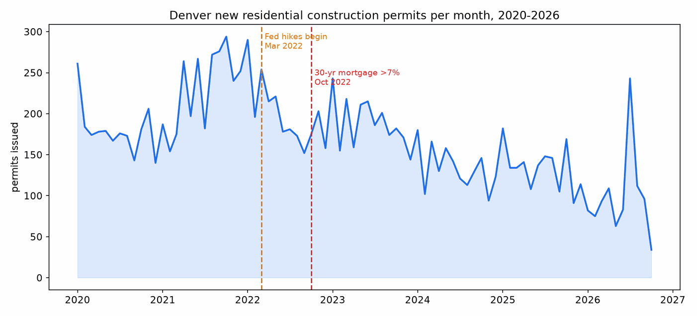
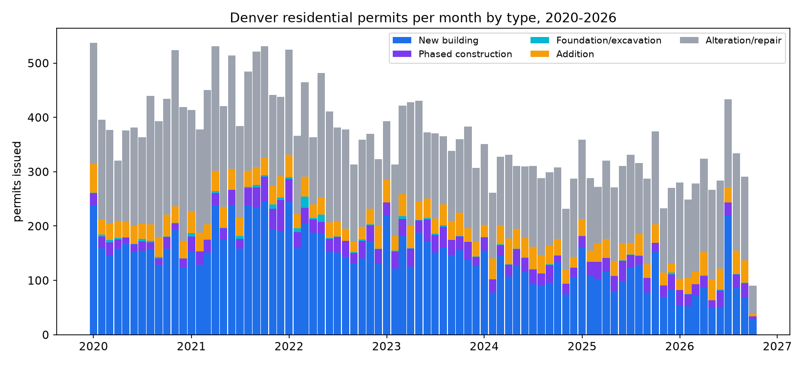
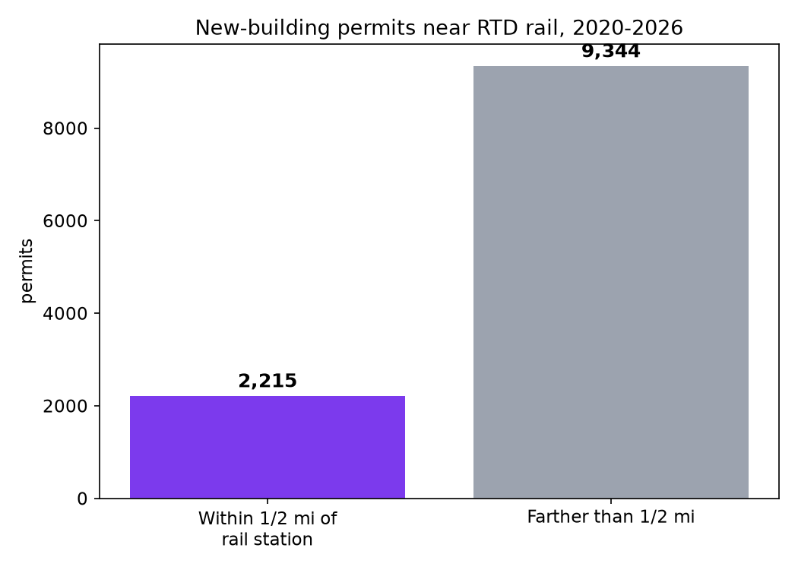
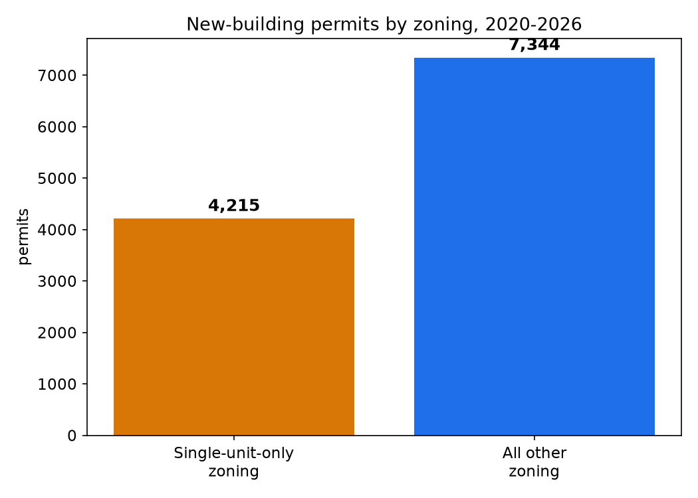

# Where Denver Builds (and Where It Doesn't): A Data Brief

*What 30,902 residential construction permits, the city's zoning map, its own Blueprint Denver growth plan, and RTD rail stations say about housing supply - and why the plan and the permits disagree.*

## The bottom line

Denver has a comprehensive plan that says where growth should go: regional centers, community corridors, and near transit. From 2020 through October 2026, the city issued 11,559 new-building residential permits. **Three-quarters of them went up outside the city's own designated growth areas. Four in five went up more than half a mile from a rail station.** The three most-built neighborhoods are all greenfield edge development - Central Park, Gateway-Green Valley Ranch, and the DIA area, all on former airport and ranch land. Meanwhile new construction volume has fallen by more than half since 2021. This is not a data problem. It is a priorities problem - the same shape as the bike-safety brief: the city mapped where action should happen, then watched it happen somewhere else.

## Finding 1: New construction has fallen by more than half

New residential construction (new buildings plus phased projects plus foundation work) averaged **205 permits a month in 2020-2021**. In 2026 year-to-date it averages **99 a month** - a 52% decline.

The 2022 rate shock did not crater permits immediately - 2022 averaged 200 a month, because permitted projects were already in the pipeline. The bleed started in 2023 (188/month), deepened in 2024 (134/month), and never recovered. This is a slow bleed, not a cliff: each year a little worse than the last.

The July 2026 spike (220 permits) is a single large project: 146 permits issued at once in Central Park. One development, not a recovery.

Alterations and remodels (13,339) now outnumber new buildings (11,559). Denver renovates more than it builds.

## Finding 2: Three-quarters of new building ignores the city's own growth plan

Blueprint Denver, the city's comprehensive plan, designates growth areas: regional centers, community centers and corridors, districts, and greenfield residential areas. Of 11,559 new-building permits:

- **2,940 (25.4%)** fall inside a Blueprint growth area
- **8,619 (74.6%)** fall outside - in the "all other areas of the city" the plan did not prioritize

Within the growth areas that did get building, the split is telling: community centers and corridors took 1,429, greenfield residential took 1,171 - and regional centers, the places the plan most wants to grow, took just 183. The plan's top priority got 1.6% of new construction.

## Finding 3: Four in five new homes go up away from rail

**2,215 of 11,559 new-building permits (19.2%)** sit within a half mile of an RTD rail station. The other 80.8% do not.

Transit-oriented development is the policy everyone endorses and almost nobody builds. Denver is adding housing where the trains are not.

## Finding 4: The map is greenfield

Five neighborhoods dominate new construction - and three are edge development on former airport and ranch land:

| Neighborhood | New buildings | Share of city total |
|---|---|---|
| Central Park | 1,075 | 9.3% |
| Gateway - Green Valley Ranch | 847 | 7.3% |
| West Colfax | 784 | 6.8% |
| DIA | 738 | 6.4% |
| Berkeley | 543 | 4.7% |

Central Park, Gateway, and DIA together account for **23% of all new residential construction** - on the suburban fringe. At the other end, four neighborhoods built nothing at all: CBD, Civic Center, Indian Creek, and Union Station recorded zero new-building permits in nearly seven years. Capitol Hill managed 10. The urban core, where demand is highest, is where the least gets built.

## Finding 5: Over a third of "new construction" is single homes where density is illegal

**4,215 of 11,559 new-building permits (36.5%)** sit on land zoned single-unit-only - districts where building anything but a detached house is against the law. Single-unit zoning covers 103 km2, about 26% of Denver's zoned land.

These are not apartment buildings. They cannot be. In SU districts the legal maximum is a single home (plus an ADU where allowed). So more than a third of everything Denver counts as "new residential construction" adds at most one or two homes per lot, by design. The market is not failing to build densely in these neighborhoods. It is forbidden to.

## Finding 6: The ADU experiment is a trickle

Denver liberalized accessory dwelling units years ago as a gentle-density strategy. Since 2020, **221 ADU permits** have been issued - about 32 a year. The trend is upward (59 in 2025, 42 through October 2026), but the absolute numbers are trivial against a housing shortage measured in the tens of thousands. Zoning allows ADUs in 2,506 of 3,777 zone polygons. Permission is not the constraint. Economics, financing, or homeowner appetite is - and the data cannot say which.

## What this does not prove

Permit counts are not unit counts. A 200-unit apartment building and a single-family teardown each count as one permit, and the dataset's unit field is 72% empty - so this analysis systematically understates multifamily's contribution to actual housing supply. The greenfield tilt would look less extreme in unit terms, because edge projects skew large. What the permit data does show reliably is *where activity happens and what the legal envelope allows*, which is the question this brief asks.

Correlation is not causation on the rate shock either. Construction fell as rates rose, but labor costs, material prices, and land prices moved too. The timing is suggestive, not conclusive.

## Methods

Five public layers, all joined spatially in EPSG:26913:

1. **Residential construction permits** (31,170 issued 2020-01-02 through 2026-10-08; 30,902 after dropping 195 cancelled and 73 with no geometry). Classified from the CLASS field, normalized for case variants: new building, addition, alteration/repair, phased construction, foundation/excavation, change of use, non-building structure, administrative. ADU flagged by "ADU" in the address string (verified by sample).
2. **Zoning** (3,777 polygons): single-unit-only defined as ZONE_USE_FORM = 'SU'.
3. **Blueprint Denver future places** (183,606 polygons): growth area defined as GROWTH_FUTURE other than "All other areas of the city".
4. **RTD rail stations** (67, extracted from RTD's public GTFS feed as stops serving rail routes): half-mile (804.67 m) buffers.
5. **Statistical neighborhoods** (78 polygons) for aggregation.

Point-in-polygon joins for zoning, growth areas, and neighborhoods; buffer containment for transit. Analysis code: `code/analyze.py`. Downloads: `code/download.py`.

## Data sources

All public:

- Residential Construction Permits - City and County of Denver, ArcGIS Hub (`ODC_DEV_RESIDENTIALCONSTPERMIT_P`, updated daily from Accela)
- Zoning - City and County of Denver, ArcGIS Hub (`ODC_ZONE_ZONING_A`)
- Blueprint Denver Future Places - City and County of Denver, ArcGIS Hub (`ODC_PLAN_BPFUTUREPLACES_A`)
- Statistical Neighborhoods - City and County of Denver, ArcGIS Hub (`ODC_ADMN_NEIGHBORHOOD_A`)
- RTD rail stations - derived from RTD's public GTFS feed (rtd-denver.com)

## Caveats

- **Permits are not completions.** Some permitted projects never break ground; others are still in the pipeline. Issuance overstates built housing by an unknown margin.
- **No unit counts.** The UNITS field is 72% null, so everything here is permit counts. Multifamily projects are underweighted relative to their true housing contribution.
- **2026 is partial** (through October 8); October reads low because the month is incomplete.
- **Zoning is a 2026 snapshot.** Rezonings between 2020 and 2026 are not reflected; a handful of permits may be misclassified by current zoning.
- **73 permits had no geometry** and 210 lacked a neighborhood assignment; they are counted in citywide totals but excluded from maps and spatial splits. 137 permits fell outside all zoning polygons (edge effects).
- **ADU detection is string matching** on addresses ("ADU", "DADU"). Unpermitted ADUs and ADUs permitted without the address flag are missed; the 221 is a floor.

## Reproduce

1. Download the five layers above (Denver: https://denvergov.org/opendata; RTD GTFS: https://www.rtd-denver.com/)
2. Run `python code/download.py` (or place files in `data/`)
3. Run `python code/analyze.py`
4. Charts land in `output/charts/`; enriched layers in `output/`

Requires Python 3 with geopandas, shapely, matplotlib.
